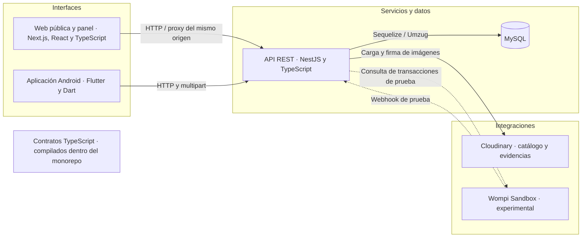

# Home Fashion

**Plataforma web y móvil para gestionar la venta, fabricación y entrega de muebles.**

Home Fashion nació como proyecto de grado de Ingeniería de Sistemas de la Universidad de Ibagué para una mueblería familiar de la ciudad. El negocio necesitaba coordinar información que se manejaba por separado entre la atención comercial, el inventario, los talleres y la entrega. El sistema reúne esos registros y vincula cada cotización, venta, pago y avance al pedido correspondiente. Así, el personal puede consultar el historial del proceso, el taller puede reportar su trabajo y el cliente puede seguir su pedido.

[Recorrido comercial](#recorrido-comercial) · [Usuarios y permisos](#usuarios-y-permisos) · [Arquitectura](#arquitectura) · [Instalación](#instalación) · [Base de datos](#base-de-datos) · [Pruebas y estado](#pruebas-y-estado) · [Referencia técnica](docs/PROJECT.md)

## Recorrido comercial

1. **Catálogo y solicitud.** El cliente consulta categorías, productos, variantes, acabados, fotografías y disponibilidad. Puede solicitar una cotización sin crear una cuenta.
2. **Cotización y venta.** El personal gestiona al cliente, revisa la solicitud, prepara la propuesta y registra su aceptación. Una cotización aceptada se puede convertir una sola vez en venta. El panel también permite registrar ventas directas.
3. **Pagos y pedido.** El personal autorizado registra abonos y consulta el saldo. De una venta confirmada se puede generar un pedido. El cobro en línea con Wompi es experimental y está limitado a Sandbox.
4. **Inventario o taller.** Una línea `IN_STOCK` reserva unidades de una variante en el inventario de muebles terminados. Una línea `MADE_TO_ORDER` se asigna a un taller y admite avances con fotografías de cámara o galería. El personal autorizado revisa y aprueba o rechaza esos avances. Un mismo pedido puede combinar ambas modalidades.
5. **Seguimiento y entrega.** El personal puede emitir, rotar o revocar un enlace privado de seguimiento. El cliente consulta el estado y los avances aprobados a través de una vista con información limitada. El personal programa, inicia y cierra la entrega con evidencia fotográfica. Al entregar una línea de inventario se descuentan las unidades físicas y se libera su reserva. La cancelación se controla por estado y libera las reservas que correspondan.

El panel también permite administrar el catálogo, mantener cuentas internas y consultar movimientos de inventario. La API controla el acceso a costos, precios, operaciones financieras, evidencias y datos de clientes.

## Usuarios y permisos

| Usuario | Responsabilidad y acceso |
| --- | --- |
| **ADMIN** | Administra cuentas y permisos, catálogo e inventario, clientes, cotizaciones, ventas, pagos, pedidos, revisión de avances, seguimiento y entregas. La API comprueba el permiso efectivo de cada operación. |
| **EMPLOYEE** | Usa el panel para las tareas habilitadas. La edición de precios y costos, el acceso financiero, la gestión de usuarios y otras operaciones restringidas requieren permisos efectivos. |
| **WORKSHOP** | Usa la aplicación Android para consultar los trabajos asignados y registrar avances. La API restringe el acceso a los trabajos propios y limita los datos que recibe. |
| **Cliente público** | Consulta el catálogo y solicita cotizaciones sin cuenta. Accede al seguimiento si dispone de un enlace válido. |

## Arquitectura



| Ruta | Contenido |
| --- | --- |
| [`apps/web`](apps/web/) | Catálogo, solicitudes, seguimiento, panel y proxy de Next.js. |
| [`apps/api`](apps/api/) | Reglas de negocio, autorización, persistencia y servicios externos. |
| [`apps/mobile`](apps/mobile/) | Sesión y operación del taller en Android. |
| [`packages/shared`](packages/shared/) | Contratos TypeScript dentro del workspace pnpm. Flutter consume los contratos HTTP con modelos Dart. |

El repositorio contiene configuraciones de Vercel para la web y la API como proyectos separados. La API admite MySQL administrado en Aiven con TLS y usa Cloudinary para medios. El [procedimiento de operación](docs/PROJECT.md#despliegue-y-configuración) detalla la configuración y las validaciones requeridas.

## Instalación

Se verificó el entorno Windows con Node.js **22.19.0**, pnpm **11.13.1** y MySQL **8.4**. Para el móvil, instala Flutter con Dart compatible con [`pubspec.yaml`](apps/mobile/pubspec.yaml) y el SDK de Android. La validación E2E requiere Chromium de Playwright. El empaquetador de fuentes usa Python.

```bash
git clone https://github.com/IngenieroCui/Home_Fashion.git
cd Home_Fashion
corepack enable
pnpm install --frozen-lockfile
```

Copia [`.env.example`](.env.example) a `.env` en la raíz. Configura `DB_HOST`, `DB_PORT`, `DB_NAME`, `DB_USER` y `DB_PASSWORD` para tu instancia local. Genera valores diferentes para `JWT_ACCESS_SECRET` y `JWT_REFRESH_SECRET`, cada uno de al menos 32 caracteres. Usa `DB_SSL_MODE=DISABLED` únicamente con MySQL descartable en loopback. Para TLS, deja `DB_SSL_MODE=REQUIRED` y proporciona la CA según [la referencia técnica](docs/PROJECT.md#despliegue-y-configuración). Las cargas de imágenes requieren las variables Cloudinary de una cuenta de pruebas. Wompi puede permanecer desactivado.

Crea un esquema vacío y un usuario dedicado desde la consola administrativa de **tu MySQL local**. Sustituye la contraseña de ejemplo y usa ese mismo valor en `.env`.

```sql
CREATE DATABASE home_fashion CHARACTER SET utf8mb4 COLLATE utf8mb4_unicode_ci;
CREATE USER 'home_fashion'`'localhost' IDENTIFIED BY 'reemplazar_por_un_valor_aleatorio_local';
GRANT SELECT, INSERT, UPDATE, DELETE, CREATE, ALTER, INDEX, REFERENCES
  ON home_fashion.* TO 'home_fashion'`'localhost';
```

Desde la raíz, aplica las migraciones y seeders sobre el esquema descartable. El seeding incluye roles y datos de catálogo de demostración. El alta administrativa requiere un nombre, un correo sintético y una contraseña local de ocho caracteres o más.

```bash
pnpm db:migrate
pnpm db:migrate:status
pnpm db:seed
pnpm db:seed:status
pnpm --filter @home-fashion/api admin:create "Operador local" operador@example.test "REEMPLAZAR_PASSWORD_LOCAL"
```

Inicia `pnpm dev:api` y `pnpm dev:web` en dos terminales o usa `pnpm dev`. El panel y catálogo usan `http://localhost:3000`. La API usa `http://localhost:3001/api` y expone `GET /api/health`.

```bash
cd apps/mobile
flutter pub get
flutter run --dart-define=API_BASE_URL=http://10.0.2.2:3001/api
```

`10.0.2.2` apunta al equipo anfitrión desde Android Emulator. En un dispositivo físico usa la IP local del equipo para debug. La compilación release exige HTTPS y firma externa. [Guía de Android](apps/mobile/README.md).

## Base de datos

El esquema tiene **21 migraciones** y **28 tablas de aplicación**. Umzug registra migraciones en `SequelizeMeta` y el comando de seeders usa `SequelizeData`. El entorno E2E aplica el seeder de roles directamente y tiene **30 tablas** en total, incluido su marcador de aislamiento. La aplicación desactiva la sincronización automática del esquema.

Las relaciones enlazan catálogo y variantes con líneas de cotización, venta y pedido. Un cliente puede tener varias cotizaciones y ventas. Cada cotización origina como máximo una venta y cada venta, como máximo un pedido. Las líneas de pedido relacionan variantes reservadas o trabajos de taller. El pedido agrupa seguimiento y entrega. Los importes, pagos e imágenes comerciales conservan su historial. [Modelo y relaciones](docs/PROJECT.md#modelo-de-datos).

## Pruebas y estado

```bash
pnpm lint
pnpm build
pnpm test
pnpm test:e2e:typecheck
pnpm test:release
pnpm test:source-package
```

`pnpm build` compila contratos, API y web. `pnpm test` ejecuta Jest para la API y `node:test` para la web. En `apps/mobile` ejecuta `flutter analyze`, `flutter test` y `flutter build apk --debug --dart-define=API_BASE_URL=http://10.0.2.2:3001/api`. Los recorridos de navegador y las regresiones financieras tienen su propio [procedimiento de QA con MySQL aislado](tests/e2e/README.md).

El proyecto permite demostrar el recorrido comercial con datos sintéticos. La [evidencia técnica](docs/PROJECT.md#pruebas-y-evidencia) identifica el commit, el entorno y el alcance de las pruebas. Para el cierre académico queda la evaluación con usuarios y una prueba en Android contra HTTPS. La operación comercial requiere verificar Cloudinary y Vercel en entornos aislados, resolver la gestión de medios históricos y completar los controles de respaldo, privacidad y distribución. El webhook externo de Wompi requiere credenciales Sandbox y un endpoint HTTPS autorizado.

## Autoría y créditos

**Juan David Reyes Cure** · Ingeniería de Sistemas, Universidad de Ibagué. Las contribuciones previas conservan su atribución en el historial Git. Las fuentes y condiciones de uso de las fotografías demostrativas figuran en [Créditos de imágenes](CATALOG_DEMO_IMAGES.md).
