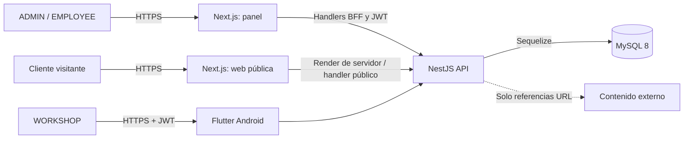
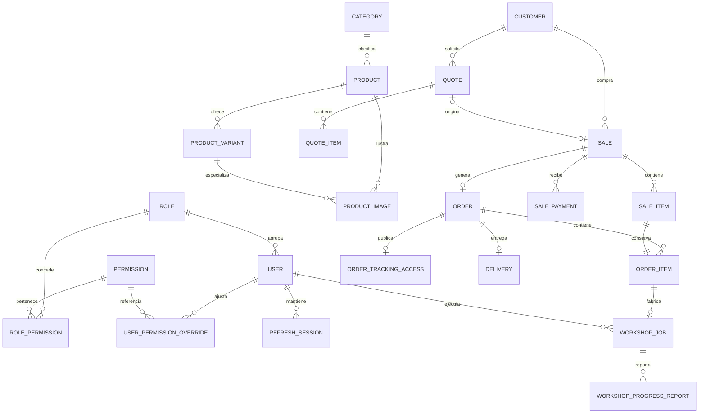
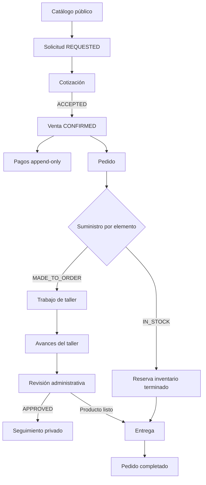
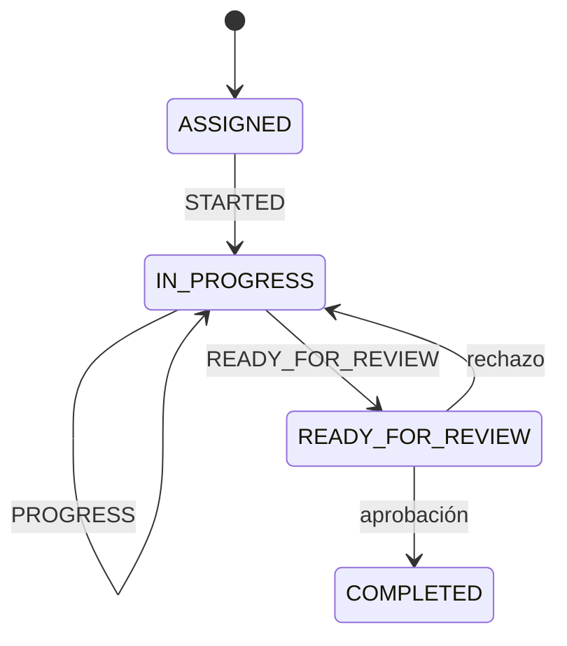
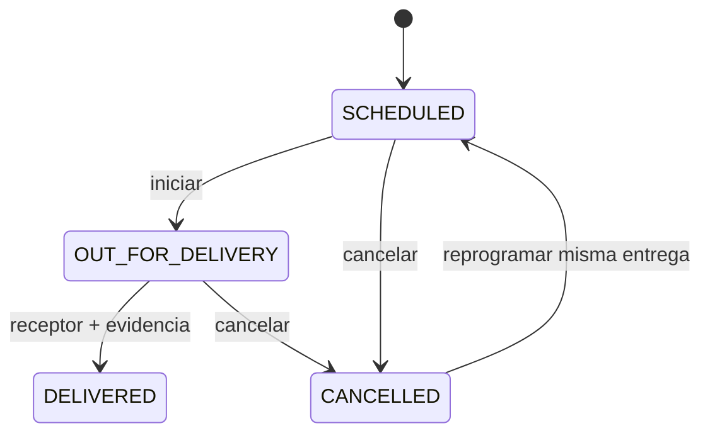

# Arquitectura del sistema Home Fashion

> Estado documental: 7 de agosto de 2026. Esta descripción corresponde al código del MVP presente en el repositorio. El sistema compila y cuenta con pruebas automáticas, pero la integración completa con MySQL, navegador y un dispositivo Android sigue pendiente de ejecución manual.

## 1. Propósito y alcance

Home Fashion digitaliza el recorrido comercial y productivo de una mueblería familiar: catálogo, solicitudes, clientes, cotizaciones, ventas, pagos, pedidos, inventario de muebles terminados, fabricación en talleres externos, revisión de avances, seguimiento privado y entregas.

La arquitectura se diseñó para un MVP mantenible y desplegable con recursos moderados. Sus decisiones permanentes son:

- monorepo administrado con pnpm para los proyectos TypeScript;
- API como monolito modular NestJS;
- web pública y panel administrativo en una sola aplicación Next.js;
- aplicación Flutter exclusiva para talleres y enfocada en Android;
- persistencia MySQL con Sequelize y `sequelize-typescript`;
- esquema administrado únicamente mediante migraciones explícitas (`synchronize: false`);
- sin Docker, microservicios, Redis, Nx ni Turborepo;
- evidencias representadas como URLs; el MVP no carga archivos;
- backend como autoridad para permisos, precios, totales y transiciones de estado.

## 2. Vista de contexto

Los navegadores no reciben los JWT del panel. Next.js actúa como backend para frontend (BFF): guarda los tokens en cookies HttpOnly y realiza las llamadas autenticadas a NestJS. Flutter sí consume NestJS directamente y guarda sus tokens en el almacenamiento seguro del dispositivo.

## 3. Estructura del monorepo

| Ruta | Responsabilidad | Tecnología principal |
| --- | --- | --- |
| `apps/api` | Reglas de negocio, seguridad, persistencia y API HTTP | NestJS 11, Sequelize 6, MySQL |
| `apps/web` | Catálogo público, seguimiento y panel administrativo | Next.js 15, React 19, Tailwind CSS 4 |
| `apps/mobile` | Operación de trabajos asignados a talleres | Flutter, Dio, BLoC, GoRouter |
| `packages/shared` | Constantes TypeScript reutilizables | TypeScript |
| `docs` | Contexto, arquitectura, operación y prueba manual | Markdown |

La raíz contiene los comandos comunes. Flutter no forma parte del workspace pnpm y se valida desde `apps/mobile`.

## 4. Vista de contenedores y despliegue

El despliegue mínimo requiere tres procesos o servicios:

1. MySQL 8 con almacenamiento persistente y copias de seguridad.
2. NestJS ejecutando el artefacto compilado de `apps/api`.
3. Next.js ejecutando el artefacto compilado de `apps/web`.

La app Android se distribuye como APK para pruebas o AAB para una tienda. En producción, Next.js y NestJS deben publicarse detrás de HTTPS. `API_SERVER_URL` debe ser alcanzable desde el servidor Next.js y `API_BASE_URL` debe ser HTTPS para una compilación Flutter release.

La API no habilita CORS porque la web usa llamadas de servidor y handlers del mismo origen; Flutter no está sujeto a CORS de navegador. Si en el futuro un cliente web consume NestJS directamente desde otro origen, será necesario definir una política CORS explícita y restrictiva.

## 5. Arquitectura de la API

La API usa un monolito modular. Cada módulo agrupa controlador, servicio, DTO, entidades y pruebas cuando corresponde.

| Módulo | Responsabilidad |
| --- | --- |
| `auth` | Login, refresh rotativo, logout, usuario autenticado, roles y permisos |
| `catalog` | Categorías, productos, variantes, imágenes por URL e inventario terminado |
| `quotes` | Clientes, cotizaciones, elementos y negociación |
| `public-quote-requests` | Solicitud pública idempotente sin aceptar precios del cliente |
| `sales` | Ventas, snapshots financieros, pagos y anulaciones append-only |
| `orders` | Conversión de venta, clasificación y reserva de inventario |
| `workshop-jobs` | Asignación, trabajos propios, avances y revisión administrativa |
| `order-tracking` | Tokens privados y proyección pública segura del pedido |
| `deliveries` | Programación, despacho, recepción y evidencia de entrega |
| `database` | Conexión, migraciones, seeders y CLI Umzug |

Todas las rutas tienen el prefijo `/api`. Un `ValidationPipe` global transforma tipos, elimina propiedades no declaradas y rechaza campos adicionales. Los endpoints administrativos usan `JwtAuthGuard`, `PermissionsGuard` y permisos declarativos.

## 6. Modelo de datos

Las entidades transaccionales conservan snapshots de nombre, variante, SKU, personalización, precio y costo cuando aplica. Esto evita que un cambio posterior del catálogo altere documentos históricos.

## 7. Flujo de negocio principal

No existe una conversión automática desde la solicitud hasta la entrega. Cada frontera importante conserva una decisión del negocio y una transacción del backend.

## 8. Estados e invariantes

### 8.1 Inventario y pedidos

- La disponibilidad es `quantityOnHand - quantityReserved`.
- `IN_STOCK` requiere variante y aumenta la reserva sin descontar existencia.
- `MADE_TO_ORDER` no modifica inventario.
- La conversión de una venta bloquea la venta y las variantes afectadas.
- Una venta genera como máximo un pedido y cada `SaleItem` aparece exactamente una vez.
- El pedido se deriva de sus elementos; un pedido `CANCELLED` no se reabre automáticamente.

### 8.2 Fabricación

El taller nunca aprueba sus reportes. Un avance empieza en `PENDING_REVIEW`; solo `APPROVED` entra en la proyección pública.

### 8.3 Pagos

- Los movimientos son append-only.
- Una corrección anula el movimiento y conserva responsable, fecha y motivo.
- Pagado, saldo y estado se derivan de movimientos `REGISTERED`.
- El registro y la anulación bloquean la venta para proteger el saldo.
- Los importes se manejan como decimales; no se confía en totales enviados por el navegador.

### 8.4 Entregas

Completar exige nombre del receptor y entre una y cinco URLs válidas. No modifica pagos ni cantidades de inventario.

## 9. Autenticación y autorización

Los roles vigentes son `ADMIN`, `EMPLOYEE` y `WORKSHOP`.

- `ADMIN` recibe todos los permisos registrados.
- `EMPLOYEE` recibe permisos operativos sembrados y puede tener overrides.
- `WORKSHOP` solo consulta sus trabajos y reporta avances.
- Los overrides se aplican sobre los permisos del rol; un `DENY` tiene precedencia para usuarios no ADMIN.

El access token es breve. El refresh token rota en cada renovación y solo se persiste su hash. Logout revoca la sesión. Las contraseñas se almacenan con bcrypt. La provisión inicial se hace por CLI y no mediante un endpoint público.

En la web, las cookies son HttpOnly, `SameSite=Lax` y `Secure` en producción. Los componentes cliente llaman handlers de Next.js; estos renuevan una vez ante 401 y nunca devuelven tokens al navegador.

El seguimiento usa 32 bytes aleatorios. Solo se guarda SHA-256, el token completo se muestra una vez y puede rotarse, revocarse o expirar. Una respuesta pública no incluye datos personales, financieros ni internos.

## 10. Arquitectura web

Next.js App Router contiene tres superficies:

- sitio público: inicio, catálogo y solicitud;
- panel: flujos administrativos protegidos por sesión y permiso;
- seguimiento: vista pública protegida por un token de alta entropía.

Las páginas son Server Components por defecto. Las interacciones complejas viven en componentes cliente, pero consumen handlers `/api/...` del mismo origen. Los módulos `src/lib/*` concentran acceso a NestJS, contratos de vista y normalización de errores.

Esta separación evita exponer el refresh token o la URL interna de la API. El panel oculta acciones según permisos como ayuda de UX, pero NestJS vuelve a verificar cada operación.

## 11. Arquitectura móvil

Flutter usa organización por funcionalidades:

- `core`: configuración, cliente HTTP, almacenamiento y errores;
- `features/auth`: sesión y autenticación;
- `features/workshop_jobs`: listado, detalle y avances;
- `app`: dependencias, router y tema.

Dio añade el bearer token y coordina un único refresh para respuestas 401 concurrentes. Cada petición se reintenta como máximo una vez. Un identificador de época de sesión impide que un refresh antiguo restaure credenciales después de logout o de un nuevo login.

BLoC/Cubit administra sesión, listado y detalle. GoRouter aplica guardas para `/login`, `/home` y `/jobs/:id`. El almacenamiento seguro conserva los tokens. En release se rechaza una `API_BASE_URL` que no sea HTTPS.

## 12. Persistencia y cambios de esquema

`synchronize` permanece desactivado. Umzug ejecuta migraciones y seeders por separado y registra sus historiales en `SequelizeMeta` y `SequelizeData`.

Las migraciones crean restricciones únicas, claves foráneas, índices y `CHECK`; por ello el entorno objetivo debe usar MySQL 8 moderno. Los cambios compuestos se ejecutan dentro de transacciones cuando MySQL lo permite.

Los seeders actuales incluyen dos clases de datos:

- catálogo de demostración;
- roles y permisos esenciales.

`pnpm db:seed` aplica ambos. Es apropiado para desarrollo y demostración, pero un despliegue con catálogo real debe decidir explícitamente si acepta esos registros de ejemplo. Antes de una puesta en producción definitiva conviene separar el seeder esencial del seeder de demostración.

## 13. Calidad y observabilidad

El repositorio incluye pruebas unitarias y de controladores/servicios en API, pruebas de DTO, migraciones, seeders, estados y concurrencia simulada. Flutter incluye pruebas de configuración, red, autenticación, navegación, formularios y estados de listado.

El endpoint `GET /api/health` funciona como comprobación de proceso, no como diagnóstico profundo de MySQL. Aún no existen métricas, trazas distribuidas, logging estructurado, alertas ni auditoría general consultable. Son mejoras de operación posteriores al MVP.

## 14. Límites y riesgos conocidos

- No hay upload: imágenes y evidencias son URLs y la API no verifica su contenido remoto.
- No hay rate limiting implementado para login, solicitud pública o seguimiento.
- No hay contrato OpenAPI/Swagger generado.
- No hay recuperación de contraseña ni interfaz de administración de usuarios/permisos.
- No hay kardex; el inventario terminado se ajusta directamente y se reserva al crear pedidos.
- No hay modo offline móvil; una red lenta conserva y comunica errores, pero la operación requiere conectividad.
- El proyecto Flutter solo contiene Android; iOS está fuera del MVP.
- La firma Android release no está configurada en el repositorio y debe administrarse como secreto externo.
- No se ha validado aún un despliegue productivo ni el recorrido completo con MySQL real.

## 15. Reglas para evolucionar la arquitectura

1. Mantener las reglas de negocio y permisos en NestJS.
2. Preservar snapshots históricos y movimientos append-only.
3. Aplicar cambios de esquema solo con migraciones reversibles y revisadas.
4. Proteger con transacciones y bloqueos las operaciones de saldo, reserva y transición concurrente.
5. No introducir infraestructura adicional sin una necesidad medible.
6. No exponer costos, datos del cliente, taller o comentarios internos en rutas públicas.
7. Añadir una integración de archivos detrás de una abstracción; no guardar rutas locales como evidencia.
8. Actualizar esta arquitectura y la guía de la aplicación afectada cuando cambien rutas, estados o variables.

## 16. Documentos relacionados

- [Índice de documentación](index.md)
- [Matriz de trazabilidad](traceability.md)
- [API](api.md)
- [Web](web.md)
- [Aplicación móvil](mobile.md)
- [Desarrollo local](development.md)
- [Smoke test del MVP](smoke-test-mvp.md)
- [Contexto maestro de tesis](tesis.md)
