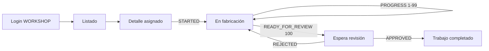

# Aplicación móvil de talleres

Referencia de `apps/mobile`, la aplicación Flutter usada por usuarios `WORKSHOP` para consultar trabajos y reportar fabricación.

> Alcance actual: Android. El repositorio no contiene proyecto iOS.

## 1. Función en el MVP

La app permite:

- iniciar y restaurar una sesión de taller;
- ver únicamente trabajos asignados al usuario autenticado;
- buscar, filtrar y paginar trabajos;
- consultar producto, variante, cantidad, personalización, instrucciones y fecha esperada;
- reportar inicio, avance y listo para revisión;
- adjuntar hasta cinco URLs de evidencia;
- consultar historial y decisión administrativa;
- cerrar sesión de forma segura.

No muestra clientes, precios, costos, pagos ni trabajos ajenos. No aprueba reportes y no accede al panel web.

## 2. Arquitectura interna

| Carpeta | Responsabilidad |
| --- | --- |
| `lib/app` | Bootstrap, dependencias, tema y router |
| `lib/core/config` | Lectura y validación de `API_BASE_URL` |
| `lib/core/network` | Dio, JWT, refresh coordinado y errores HTTP |
| `lib/core/storage` | Tokens en `flutter_secure_storage` |
| `lib/core/widgets` | Estados de carga, vacío y error |
| `lib/features/auth` | Repositorio, modelos, cubit y login |
| `lib/features/workshop_jobs` | Datos, dominio, cubits, listado, detalle y formulario |

Dependencias principales: Dio, flutter_bloc, flutter_secure_storage, go_router y flutter_localizations. El idioma de la aplicación y los controles Material es español de Colombia (`es-CO`).

## 3. Rutas de navegación

| Ruta | Acceso | Vista |
| --- | --- | --- |
| `/splash` | Restaurando/cerrando sesión | Espera mientras se recupera o limpia la sesión |
| `/login` | No autenticado | Correo y contraseña |
| `/home` | WORKSHOP autenticado | Listado de trabajos |
| `/jobs/:id` | WORKSHOP autenticado | Detalle, historial y acciones disponibles |

GoRouter redirige al login sin sesión y al inicio con sesión. Un usuario autenticado que no sea WORKSHOP se rechaza y sus tokens no habilitan el flujo.

## 4. Endpoints consumidos

| Método | Endpoint NestJS | Uso |
| --- | --- | --- |
| POST | `/auth/login` | Obtener access y refresh |
| GET | `/auth/me` | Restaurar/confirmar usuario WORKSHOP |
| POST | `/auth/refresh` | Rotar sesión |
| POST | `/auth/logout` | Revocar refresh |
| GET | `/workshop/jobs` | Listado propio |
| GET | `/workshop/jobs/:id` | Detalle propio |
| POST | `/workshop/jobs/:id/progress` | Reporte append-only |

`API_BASE_URL` ya incluye `/api`, por ejemplo `https://api.example.com/api`.

## 5. Configuración de red

La URL se define en compilación/ejecución con `--dart-define`; `.env.example` es solo referencia y la aplicación no lee un archivo `.env`.

### Emulador Android

`10.0.2.2` representa el computador anfitrión:

```bash
cd apps/mobile
flutter pub get
flutter run --dart-define=API_BASE_URL=http://10.0.2.2:3001/api
```

### Dispositivo físico

Conecta el dispositivo y el computador a la misma red, permite el puerto local y usa la IP LAN del computador:

```bash
flutter run --dart-define=API_BASE_URL=http://192.168.1.10:3001/api
```

La API debe escuchar en una interfaz accesible. No uses `localhost` en el teléfono: apuntaría al propio dispositivo.

### Producción

```bash
flutter build appbundle --release --dart-define=API_BASE_URL=https://api.example.com/api
```

`AppConfig` rechaza HTTP en release. Android permite cleartext local únicamente con el manifiesto/configuración debug; la excepción no se incluye en release.

## 6. Sesión y red

- Los tokens se guardan mediante almacenamiento seguro.
- Dio añade el access token a las rutas protegidas.
- Varias respuestas 401 concurrentes esperan un solo refresh.
- Cada solicitud se reintenta una vez como máximo.
- El refresh rota ambos tokens y sustituye los anteriores.
- Una época de sesión evita que una respuesta atrasada reviva credenciales después de logout/login.
- Si refresh o reintento falla, se limpia la sesión y el router vuelve al login.
- Timeouts configurados: conexión/envío 15 s y recepción 20 s.

No existe cola offline. Ante pérdida de red el usuario recibe un error y debe reintentar; el formulario debe conservar el contenido mientras la vista permanezca activa.

## 7. Flujo de fabricación



### STARTED

Disponible cuando el trabajo está `ASSIGNED`. Requiere mensaje. Cambia el trabajo a `IN_PROGRESS` y el elemento del pedido a `IN_PRODUCTION`.

### PROGRESS

Disponible en `IN_PROGRESS`. Requiere mensaje y permite porcentaje 1–99. No cambia el estado del trabajo.

### READY_FOR_REVIEW

Disponible en `IN_PROGRESS`. El backend fuerza 100 y deja el trabajo esperando decisión. Un rechazo permite enviar un nuevo avance; una aprobación completa el trabajo.

Las evidencias opcionales deben ser URLs absolutas accesibles. No selecciones rutas locales como `C:\...` o `/storage/...`: no existe upload.

## 8. Ejecución y pruebas

```bash
cd apps/mobile
dart format --set-exit-if-changed lib test
flutter analyze
flutter test
```

La suite cubre configuración, cliente HTTP, repositorio de autenticación, sesión, guardas de navegación, login, listado, repositorio de trabajos y formulario de avances.

En la revisión del 7 de agosto de 2026, `dart analyze` terminó sin hallazgos. `flutter test` no llegó a iniciar dentro del sandbox actual y debe repetirse en una terminal local antes de distribuir; esto es una limitación de la ejecución, no una prueba aprobada ni un defecto confirmado.

Prueba manual mínima:

1. Crear un usuario WORKSHOP y un trabajo asignado desde la web.
2. Iniciar sesión con Android.
3. Verificar que no aparecen trabajos de otro taller.
4. Enviar STARTED, PROGRESS y READY_FOR_REVIEW.
5. Rechazar desde web y confirmar comentario en móvil.
6. Reenviar listo, aprobar y confirmar estado final.
7. Vencer o invalidar el access token y comprobar refresh.
8. Cerrar sesión y confirmar que volver atrás no revela datos.

## 9. Compilación Android

### APK para prueba directa

```bash
flutter build apk --release --dart-define=API_BASE_URL=https://api.example.com/api
```

Salida habitual: `build/app/outputs/flutter-apk/app-release.apk`.

### AAB para Google Play

```bash
flutter build appbundle --release --dart-define=API_BASE_URL=https://api.example.com/api
```

Salida habitual: `build/app/outputs/bundle/release/app-release.aab`.

El repositorio no contiene keystore ni configuración de firma release. Antes de publicar:

1. Generar y respaldar un keystore fuera del repositorio.
2. Configurar Gradle con propiedades/secretos externos.
3. No guardar contraseña, `.jks` o `.keystore` en Git.
4. Definir identificador definitivo, versión y política de actualización.
5. Probar el artefacto firmado contra la API HTTPS de destino.

El `applicationId` actual es `com.homefashion.home_fashion_workshop`, la etiqueta es “Home Fashion Talleres” y la versión de `pubspec.yaml` es `0.1.0+1`.

## 10. Distribución y despliegue

Para una validación académica puede distribuirse un APK firmado de prueba por un canal controlado. Para uso operativo sostenido se recomienda una pista interna/cerrada de Google Play o una gestión formal de versiones.

Orden de despliegue:

1. Publicar MySQL/API y comprobar HTTPS.
2. Crear cuentas WORKSHOP activas.
3. Compilar con la URL definitiva; no puede cambiarse después sin una nueva build.
4. Firmar y probar en al menos un dispositivo de gama representativa.
5. Distribuir e informar versión, fecha y cambios.
6. Conservar el artefacto y los símbolos necesarios para diagnóstico.

## 11. Lista de prueba UI/UX móvil

- Pantalla pequeña, fuente ampliada y teclado visible sin ocultar la acción principal.
- Login con contraseña incorrecta, cuenta inactiva y rol no permitido.
- Listado vacío, paginación, búsqueda y filtros.
- Texto largo en instrucciones y personalización.
- Red lenta, sin red, timeout y 401 durante una operación.
- Formulario de avance conservado ante error.
- Porcentajes límite y más de cinco URLs rechazados claramente.
- Enlaces de evidencia abribles y comentario de rechazo visible.
- Contraste, tamaño táctil y navegación atrás coherentes.

## 12. Límites actuales

- Solo Android; no hay carpetas/proyecto iOS.
- Sin upload de cámara o galería.
- Sin notificaciones push.
- Sin modo offline ni sincronización diferida.
- Sin firma release configurada.
- Sin crash reporting ni analítica.
- Sin distribución productiva validada.

## 13. Solución de problemas

- **No conecta desde emulador:** usa `10.0.2.2`, no `localhost`, y confirma el puerto 3001.
- **No conecta desde teléfono:** usa IP LAN, misma red, firewall y API accesible.
- **Release rechaza URL:** debe ser HTTPS absoluta e incluir `/api`.
- **Login válido en web pero rechazado en móvil:** la cuenta debe tener rol WORKSHOP y estar activa.
- **El trabajo no aparece:** debe estar asignado al ID del usuario autenticado; revisa filtros.
- **No permite reportar:** la acción depende del estado actual y del último proceso de revisión.
- **Una evidencia falla:** usa URL absoluta HTTP/HTTPS; la app no sube archivos locales.
- **Flutter queda esperando al iniciar herramientas:** ejecuta `flutter doctor -v`, acepta licencias Android y verifica que otro proceso no tenga bloqueado el SDK.
