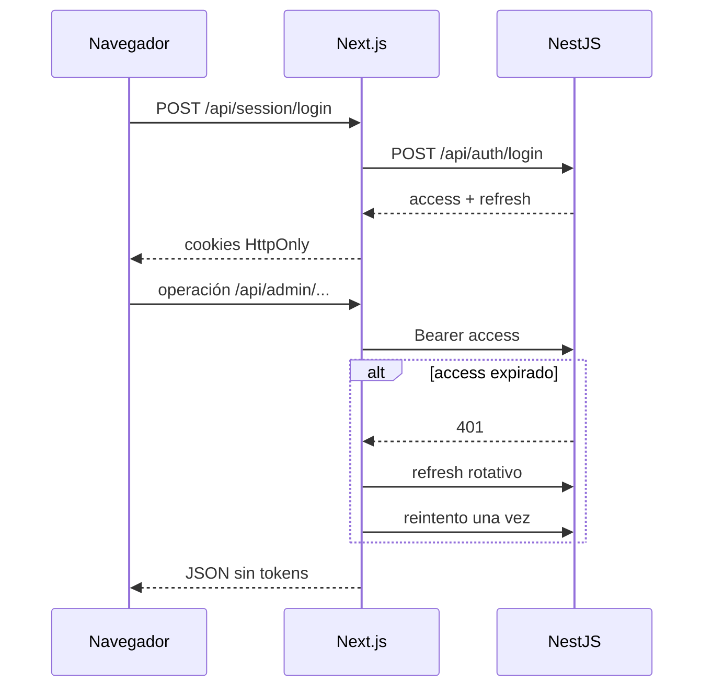

# Aplicación web de Home Fashion

Referencia de `apps/web`, que reúne el sitio público, el panel de Home Fashion y el seguimiento privado del cliente.

> URL local: `http://localhost:3000`.

## 1. Arquitectura

La aplicación usa Next.js App Router, React y Tailwind CSS. Las páginas son Server Components por defecto; los formularios y listados interactivos se implementan como Client Components.

Para el panel, Next.js funciona como BFF:



Los módulos `src/lib` concentran llamadas de servidor, tipos y manejo de sesión. `src/components` contiene la experiencia visual. Las rutas `src/app/api` son handlers internos de Next.js, no una segunda implementación de las reglas de negocio.

## 2. Variables de entorno

Copia `apps/web/.env.example` a `apps/web/.env.local` para desarrollo:

| Variable | Consumidor | Uso |
| --- | --- | --- |
| `NEXT_PUBLIC_API_URL` | Render de catálogo | Base pública de NestJS; localmente `http://localhost:3001/api` |
| `API_SERVER_URL` | Servidor Next.js | Base interna de NestJS para sesión y panel |

Quita la barra final. En producción define ambas explícitamente. `API_SERVER_URL` puede ser una dirección privada alcanzable desde el servidor Next.js; `NEXT_PUBLIC_API_URL` debe ser válida durante build/runtime según la página. No almacenes tokens ni secretos en variables `NEXT_PUBLIC_*`.

Las cookies de sesión usan `Secure` cuando `NODE_ENV=production`, por lo que la aplicación productiva debe servirse mediante HTTPS.

## 3. Ejecución local

Con MySQL migrado, la API activa y un usuario interno creado:

```bash
pnpm install --frozen-lockfile
pnpm dev:api
pnpm dev:web
```

Abre `http://localhost:3000`. ADMIN y EMPLOYEE usan `/iniciar-sesion`; WORKSHOP debe usar la app Android y el panel rechaza ese rol.

La página pública conserva mensajes institucionales si el catálogo no responde. El panel, en cambio, necesita la API para autenticar y operar.

## 4. Rutas visibles

### Sitio público

| Ruta | Propósito | Acceso |
| --- | --- | --- |
| `/` | Inicio, categorías y productos destacados | Público |
| `/catalogo` | Búsqueda, categoría, personalización, disponibilidad y paginación | Público |
| `/catalogo/[slug]` | Producto, variantes y formulario de solicitud | Público |
| `/iniciar-sesion` | Login del personal interno | Público sin sesión |
| `/seguimiento/[token]` | Estado del pedido y avances aprobados | Token privado |

Filtros compartibles del catálogo: `q`, `category`, `allowsCustomization`, `inStock`, `page`.

### Panel administrativo

| Ruta | Permiso o regla | Función |
| --- | --- | --- |
| `/panel` | Usuario interno no WORKSHOP | Inicio y accesos según permisos |
| `/panel/catalogo` | `CATALOG_MANAGE` | Categorías y productos |
| `/panel/catalogo/nuevo` | `CATALOG_MANAGE` | Crear producto |
| `/panel/catalogo/productos/[id]` | `CATALOG_MANAGE` | Editar producto y variantes |
| `/panel/clientes` | `CUSTOMER_MANAGE` | Buscar y listar clientes |
| `/panel/clientes/nuevo` | `CUSTOMER_MANAGE` | Crear cliente |
| `/panel/clientes/[id]` | `CUSTOMER_MANAGE` | Editar/desactivar cliente |
| `/panel/cotizaciones` | `QUOTE_MANAGE` | Listar y filtrar cotizaciones |
| `/panel/cotizaciones/nueva` | `QUOTE_MANAGE` | Crear borrador |
| `/panel/cotizaciones/[id]` | `QUOTE_MANAGE` | Elementos, totales, estados y conversión |
| `/panel/ventas` | `SALE_MANAGE` | Listar ventas y estado de pago |
| `/panel/ventas/nueva` | `SALE_MANAGE` | Crear venta directa |
| `/panel/ventas/[id]` | `SALE_MANAGE` | Detalle, pagos, saldo y pedido |
| `/panel/ventas/[id]/crear-pedido` | `ORDER_MANAGE` | Clasificar cada elemento y crear pedido |
| `/panel/pedidos` | `ORDER_MANAGE` | Listar pedidos |
| `/panel/pedidos/[id]` | `ORDER_MANAGE` | Operación, asignación, seguimiento y entrega |
| `/panel/talleres` | `WORKSHOP_MANAGE` o `PROGRESS_REVIEW` | Portada de operación de talleres |
| `/panel/talleres/trabajos` | `WORKSHOP_MANAGE` | Listar asignaciones |
| `/panel/talleres/trabajos/[id]` | `WORKSHOP_MANAGE` | Detalle administrativo |
| `/panel/talleres/avances` | `PROGRESS_REVIEW` | Cola de reportes |
| `/panel/talleres/avances/[id]` | `PROGRESS_REVIEW` | Aprobar o rechazar |
| `/panel/entregas` | `ORDER_MANAGE` | Listar y filtrar entregas |
| `/panel/entregas/[id]` | `ORDER_MANAGE` | Iniciar, completar o cancelar |

ADMIN pasa todas las comprobaciones registradas. Ocultar un enlace en el panel no concede ni revoca seguridad: la API verifica nuevamente el permiso.

## 5. Handlers internos de Next.js

El navegador consume estos handlers del mismo origen. Los administrativos leen cookies HttpOnly, llaman NestJS y pueden renovar la sesión una vez.

### Sesión y público

| Método | Handler | Destino principal |
| --- | --- | --- |
| POST | `/api/session/login` | `/api/auth/login`; crea cookies |
| GET | `/api/session/refresh` | `/api/auth/refresh`; rota cookies |
| POST | `/api/session/logout` | `/api/auth/logout`; elimina cookies |
| POST | `/api/public/quote-requests` | Solicitud pública; limita cuerpo a 32 KiB |

El seguimiento público se obtiene desde el servidor de la página y no tiene handler de navegador propio.

### Catálogo, clientes y cotizaciones

| Métodos | Handler |
| --- | --- |
| GET, POST | `/api/admin/catalog/categories` |
| PATCH | `/api/admin/catalog/categories/[id]` |
| GET, POST | `/api/admin/catalog/products` |
| GET, PATCH | `/api/admin/catalog/products/[id]` |
| POST | `/api/admin/catalog/products/[id]/variants` |
| PATCH | `/api/admin/catalog/variants/[id]` |
| GET, POST | `/api/admin/customers` |
| GET, PATCH | `/api/admin/customers/[id]` |
| GET | `/api/admin/quote-products` |
| GET, POST | `/api/admin/quotes` |
| GET, PATCH | `/api/admin/quotes/[id]` |
| POST | `/api/admin/quotes/[id]/items` |
| PATCH, DELETE | `/api/admin/quotes/[id]/items/[itemId]` |
| POST | `/api/admin/quotes/[id]/status` |

`quote-products` es una adaptación BFF para el selector de productos; no corresponde a un controlador NestJS con ese nombre.

### Ventas, pedidos y seguimiento

| Métodos | Handler |
| --- | --- |
| GET, POST | `/api/admin/sales` |
| GET | `/api/admin/sales/[id]` |
| POST | `/api/admin/sales/from-quote/[quoteId]` |
| POST | `/api/admin/sales/[id]/payments` |
| POST | `/api/admin/sales/[saleId]/payments/[paymentId]/void` |
| GET | `/api/admin/orders` |
| GET | `/api/admin/orders/[id]` |
| POST | `/api/admin/orders/from-sale/[saleId]` |
| GET, POST | `/api/admin/orders/[id]/tracking-access` |
| POST | `/api/admin/orders/[id]/tracking-access/revoke` |

### Talleres y entregas

| Métodos | Handler |
| --- | --- |
| GET | `/api/admin/workshop-users` |
| GET, POST | `/api/admin/workshop-jobs` |
| GET | `/api/admin/workshop-jobs/[id]` |
| GET | `/api/admin/workshop-progress` |
| GET | `/api/admin/workshop-progress/[id]` |
| POST | `/api/admin/workshop-progress/[id]/review` |
| GET | `/api/admin/delivery-assignees` |
| GET, POST | `/api/admin/deliveries` |
| GET | `/api/admin/deliveries/[id]` |
| POST | `/api/admin/deliveries/[id]/start` |
| POST | `/api/admin/deliveries/[id]/complete` |
| POST | `/api/admin/deliveries/[id]/cancel` |

Los handlers no deben usarse como API para terceros: dependen del contrato de cookies y de la interfaz web. Integraciones externas deben consumir NestJS con autenticación propia.

## 6. Flujos de uso

### Cliente

1. Consulta inicio o catálogo.
2. Filtra y abre un producto.
3. Selecciona variante o personalización permitida.
4. Envía datos de contacto, cantidad y mensaje.
5. Recibe un código de recepción, no una cotización final.
6. Más adelante usa el enlace `/seguimiento/{token}` entregado por Home Fashion.

### Personal interno

1. Inicia sesión.
2. Revisa solicitudes/cotizaciones y valida el cliente.
3. Cotiza y acepta; luego convierte a venta o crea venta directa.
4. Registra abonos y crea el pedido.
5. Clasifica inventario/fabricación y asigna taller si aplica.
6. Revisa avances y publica solo al aprobar.
7. Genera el enlace de seguimiento.
8. Programa, inicia y completa la entrega.

## 7. Sesión y seguridad

- Access y refresh se guardan en cookies HttpOnly.
- En producción las cookies son `Secure` y `SameSite=Lax`.
- El panel consulta `/auth/me` en servidor y rechaza WORKSHOP.
- Los handlers reintentan una vez después de refresh; un segundo 401 obliga a iniciar sesión.
- El token completo de seguimiento solo existe en la respuesta de creación/rotación y no puede recuperarse después de recargar.
- La vista pública no muestra nombre completo, contacto, dirección, precios, pagos, taller, instrucciones ni reportes no aprobados.
- El formulario público acepta como máximo 32 KiB en el handler de Next.js.

No se ha implementado protección CSRF explícita adicional, CSP personalizada ni rate limiting. `SameSite=Lax`, cookies HttpOnly y comprobaciones del backend son la base actual; estas medidas deben revisarse antes de exposición productiva.

## 8. Calidad y compilación

```bash
pnpm --filter @home-fashion/web lint
pnpm --filter @home-fashion/web test
pnpm --filter @home-fashion/web build
```

El build genera `.next`. La validación del 7 de agosto de 2026 aprobó lint y el build de producción, incluida la generación de las 28 páginas visibles y 40 handlers.

Hay 24 pruebas de regresión de módulos independientes de Next en `test/regressions.test.cjs`, ejecutadas con `pnpm --filter @home-fashion/web test`. Cubren sesión, redirecciones, errores, precios y renovación concurrente. No hay suite de componentes/E2E web. La calidad visual, responsive, accesibilidad y recorridos requieren navegador real.

## 9. Despliegue

1. Desplegar y migrar primero la API.
2. Instalar con `pnpm install --frozen-lockfile`.
3. Definir `NODE_ENV=production`, `NEXT_PUBLIC_API_URL` y `API_SERVER_URL` antes del build/inicio.
4. Ejecutar `pnpm --filter @home-fashion/web build`.
5. Iniciar con `pnpm --filter @home-fashion/web start` o `next start -p 3000` desde `apps/web`.
6. Publicar mediante HTTPS detrás de un proxy o servicio administrado.
7. Verificar que el servidor Next.js alcance `API_SERVER_URL` y que el navegador conserve cookies seguras.
8. Probar inicio, catálogo, login, una lectura del panel, logout y un seguimiento inválido.

Next.js usa render dinámico en las páginas que consultan datos. No puede desplegarse como exportación HTML estática. Mantén un proceso Node activo.

En un proxy con un solo dominio, envía `/` a Next.js. NestJS puede permanecer privado porque los consumidores web pasan por Next.js; la app móvil necesitará una URL pública HTTPS para la API.

## 10. Lista de prueba UI/UX

- 360 px, tableta y escritorio sin desbordamiento horizontal.
- Navegación completa con teclado y foco visible.
- Etiquetas y mensajes comprensibles sin IDs internos.
- Formulario conservado después de un error recuperable.
- Estados vacío, cargando, error, permiso denegado y sesión vencida.
- Importes COP legibles y sin redondeos inesperados.
- Confirmaciones claras para anular pagos, rotar/revocar seguimiento y cancelar entrega.
- Imágenes rotas con alternativa visual y texto apropiado.
- Datos sensibles ausentes de HTML público, logs y mensajes de error.

Usa el recorrido de [smoke-test-mvp.md](smoke-test-mvp.md) y registra navegador, resolución, evidencia y resultado.

## 11. Límites actuales

- No hay carga de imágenes/evidencias; solo URLs.
- No hay tests E2E web ni auditoría automática de accesibilidad.
- No hay interfaz de usuarios, roles u overrides.
- No hay recuperación de contraseña.
- No hay dashboard analítico; `/panel` es navegación funcional.
- No se ha validado CDN, caché productiva ni comportamiento bajo carga.
- La revisión final de identidad visual y usabilidad sigue pendiente.

## 12. Solución de problemas

- **La página pública muestra indisponibilidad:** confirma API y `NEXT_PUBLIC_API_URL`.
- **Login falla desde web pero funciona por API:** revisa `API_SERVER_URL` desde el servidor Next.js.
- **Bucle hacia iniciar sesión:** verifica HTTPS en producción, cookies `Secure`, secretos JWT y hora del sistema.
- **Un botón no aparece:** consulta permisos efectivos en `/api/auth/me`; la interfaz filtra por permiso.
- **401 tras varios minutos:** revisa que el refresh rote y que Next.js pueda escribir las cookies nuevas.
- **Seguimiento no disponible:** el token puede ser inválido, expirado, rotado o revocado; el mensaje es deliberadamente genérico.
- **Build intenta datos reales:** las páginas dinámicas toleran API inactiva donde está previsto; revisa variables y errores de fetch si cambia ese comportamiento.
